# 4 a 0

[](https://github.com/NormanFrieman/4a0/actions/workflows/ci.yml)
[](LICENSE)

Jogo de navegador, gratuito e de código aberto: você monta uma equipe com enxadristas históricos, sorteados de seleções reais das Olimpíadas de Xadrez, e disputa um torneio contra outras seleções de várias épocas. As partidas são jogadas lance a lance pelo [Maia-3](https://github.com/CSSLab), uma rede neural treinada para jogar como pessoas de cada nível.

**[▶ Jogar agora](https://4a0.ezequiel-d-s.workers.dev/)**: roda inteiro no navegador, sem conta, sem anúncios.

<p align="center">
  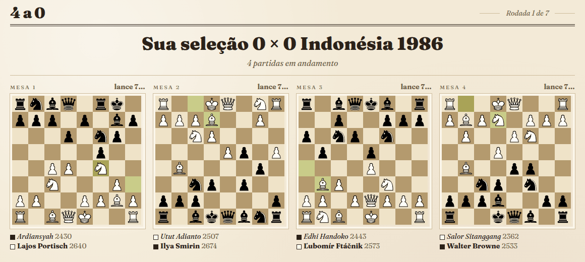
</p>

## A ideia

> E se Tal, Kasparov e Carlsen jogassem na mesma equipe, venceriam a URSS de 1980?

O nome vem do placar perfeito de um match olímpico (4 partidas, 4 vitórias) e a inspiração, do "7 a 0" e similares, em que se sorteiam seleções históricas da Copa do Mundo. Aqui, em vez de sortear resultados, o jogo **joga as partidas de verdade**: cada lance sai do Maia-3, e todas podem ser assistidas, revistas e baixadas em PGN.

## Como se joga

Uma sessão leva cerca de 15 minutos, do primeiro sorteio à medalha.

### 1. Início

Escolha o modo:

- **Clássico:** a força de cada jogador aparece nas cartas.
- **Mestre:** a força fica oculta até o fim do torneio. Você escolhe pelo que sabe da história do xadrez.

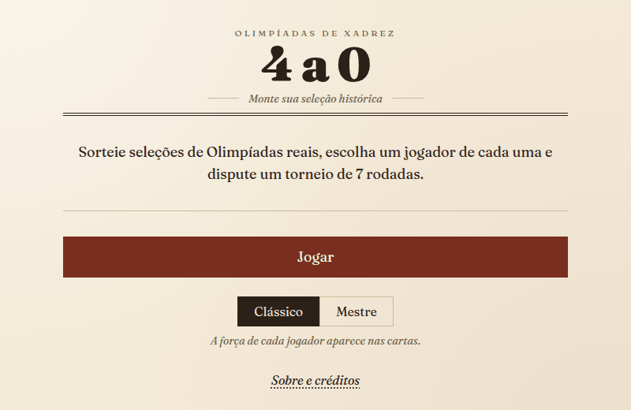

### 2. Draft: quatro sorteios, quatro escolhas

A cada sorteio aparece uma seleção real (país, ano, cidade-sede e colocação final), com a escalação das mesas 1 a 4, a pontuação real de cada jogador naquela Olimpíada e as medalhas. Você escolhe **um** jogador, e ele só pode ocupar a vaga da **mesa em que jogou na edição real**: quem foi mesa 1 só entra na mesa 1. A mesma pessoa não entra duas vezes, mesmo de edições diferentes. Há 3 re-sorteios por draft.

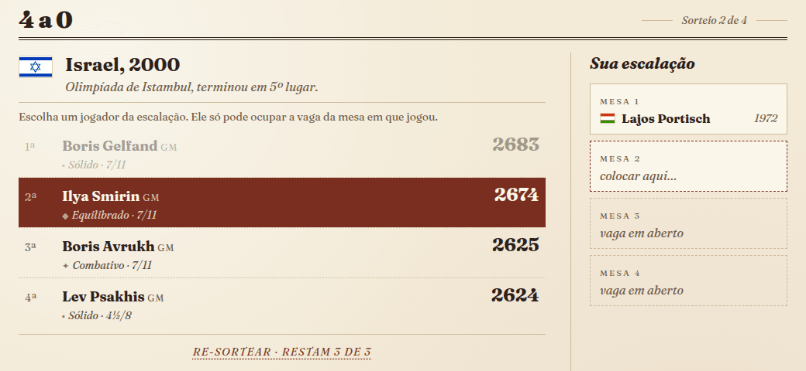

### 3. Confirmação e campo

Você revisa a equipe e o jogo sorteia o **campo**: 23 seleções históricas (24 equipes ao todo), em três faixas de força, com pelo menos 3 campeãs e no máximo 2 seleções do mesmo país.

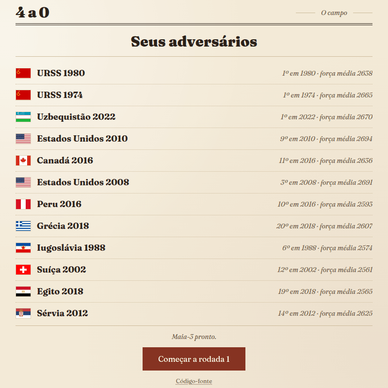

### 4. Sete rodadas no sistema suíço

Em cada rodada você vê as duas escalações e assiste ao match: as 4 partidas são calculadas pelo Maia-3 no seu navegador e reproduzidas a 1×, a 4× ou sem pausa. Os outros matches da rodada são simulados em segundo plano. Como na Olimpíada real, a vitória no match vale 2 pontos e o empate (2 a 2), 1.

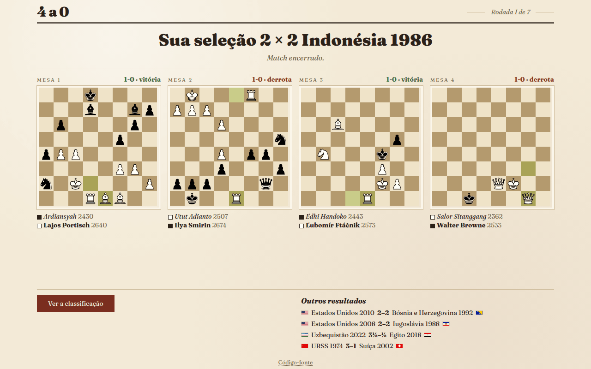

Depois de cada rodada vem a classificação: pontos de match, pontos de partida e Buchholz.

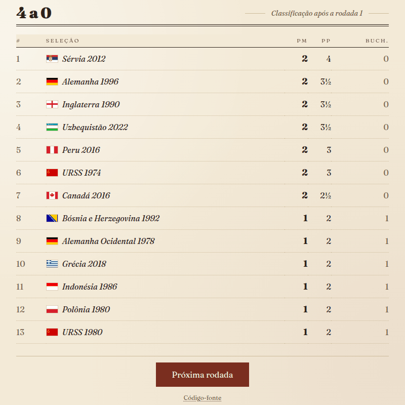

### 5. Resultado final, replay e compartilhamento

No fim aparecem a colocação e a medalha, a campanha rodada a rodada, os destaques e os prêmios individuais por mesa. Qualquer partida pode ser revista lance a lance e baixada em PGN (uma partida ou a campanha inteira). O resultado pode ser copiado como texto, no estilo Wordle, ou exportado como imagem.

<p>
  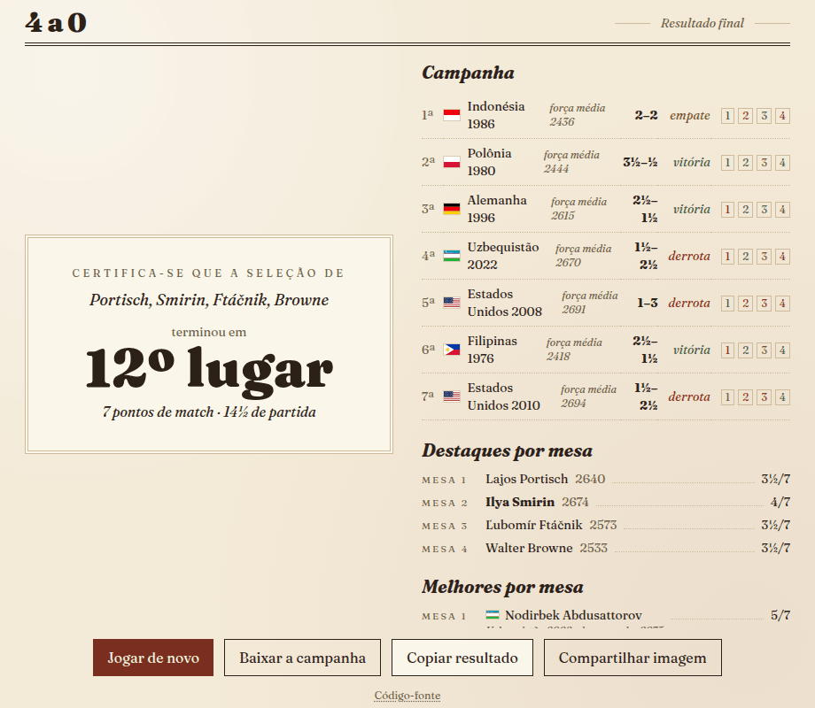
  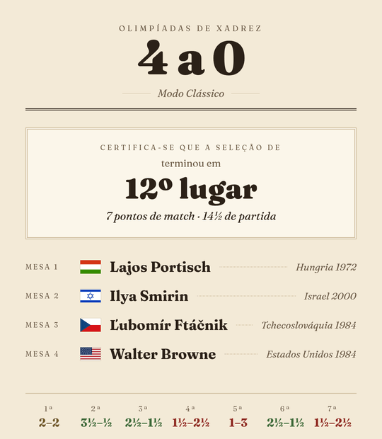
</p>

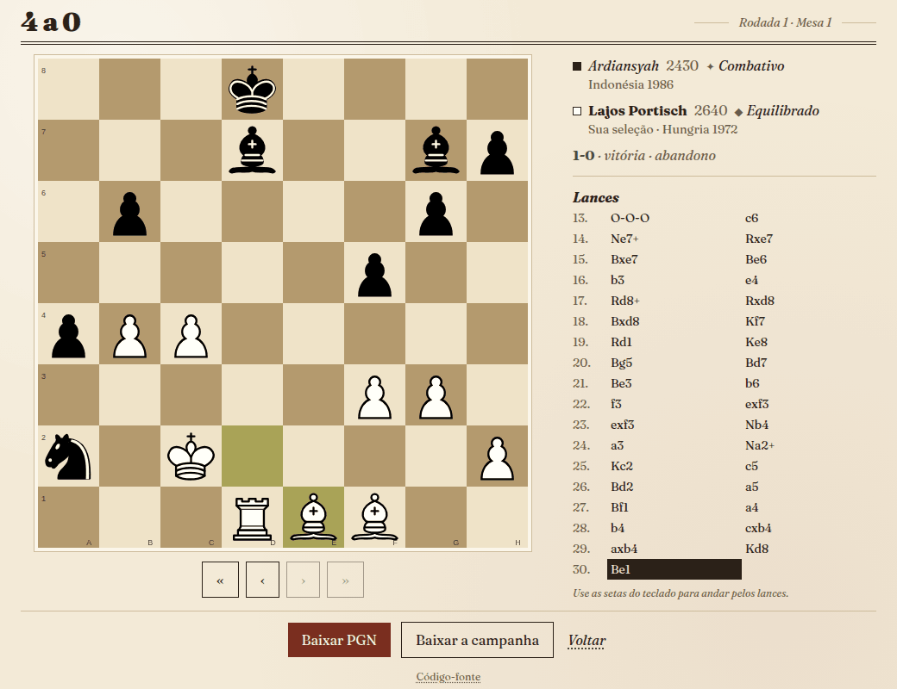

No celular, os tabuleiros ficam empilhados:

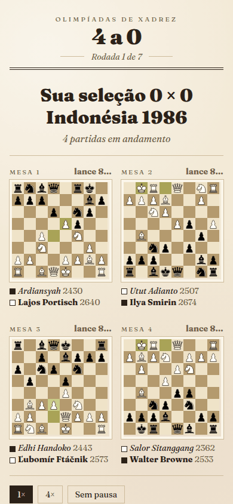

## Como funciona por dentro

O jogo é **100% estático**: HTML, JavaScript, os dados em JSON e o modelo do Maia-3 servidos pelo próprio site. Não há servidor de jogo, banco de dados nem conta. Todo o cálculo acontece no navegador de quem joga.

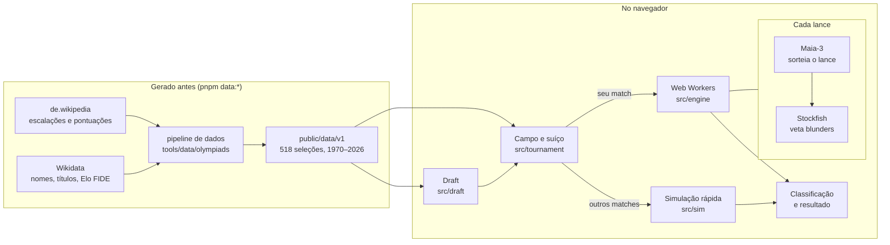

### Os jogadores: de Elo FIDE a força de jogo

Cada **carta** é uma pessoa numa Olimpíada específica (por exemplo, Karpov em 1980). A força dela combina o Elo FIDE da época com a performance naquela edição:

```text
força = Elo + 0,25 × (performance − Elo)
```

Uma campanha histórica rende um pouco mais de força, sem apagar o rating. O Maia-3 joga de 600 a 2600 na escala blitz do Lichess e comprime as diferenças. Por isso a força nunca vai direto para ele: passa por uma escala medida em milhares de partidas Maia contra Maia (`pnpm engine:ladder`, [docs/benchmarks.md](docs/benchmarks.md)), que preserva a ordem e as diferenças entre os jogadores (`src/engine/strength.ts`).

Cada jogador também tem um **estilo** (Sólido, Equilibrado ou Combativo), tirado da taxa de empates das suas partidas olímpicas reais, que muda a temperatura do sorteio dos lances: os sólidos jogam lances mais previsíveis, e os combativos arriscam mais. O `selfElo` é compensado para que o estilo não mude a força.

### As partidas: o Maia escolhe, o Stockfish veta

Para cada lance das 4 partidas do seu match:

1. O **Maia-3** recebe a posição, os últimos lances e os Elos dos dois lados e devolve uma distribuição de probabilidades sobre os lances, imitando como uma pessoa daquele nível jogaria.
2. O jogo **sorteia** um lance dessa distribuição com um gerador com semente (`src/rng/rng.ts`). Nunca usa `Math.random()` nem pega sempre o lance mais provável.
3. O **Stockfish** avalia o lance com uma busca curta de número fixo de nós. Se o lance perde mais chances de vitória do que a tolerância daquele jogador, ele é descartado e outro é sorteado. O Stockfish só recusa, nunca escolhe, e o estilo humano do Maia se mantém.
4. A partida termina por mate, empate pelas regras, abandono ou acordo, com regras ajustadas para não haver abandonos na abertura.

O Maia-3 (variante de 5 milhões de parâmetros, ~22 MB) roda em ONNX Runtime Web e o Stockfish em WebAssembly, os dois em Web Workers, com as 4 partidas em paralelo. Os matches entre as outras seleções usam uma **simulação rápida** pela fórmula de Elo, calibrada para dar uma taxa de empates coerente com a das partidas do Maia.

### Determinismo

A sessão inteira sai de uma **semente**: o draft, o campo e cada lance de cada partida (semente da partida = hash da sessão, da rodada e da mesa). O backend WASM é forçado para que o resultado não varie entre máquinas. O link "Copiar resultado" leva `?seed=…`, e um amigo que abrir o link recebe os mesmos sorteios e pode tentar fazer melhor.

## Dados

Os dados `v1` (`public/data/v1/`) trazem as **20 primeiras seleções de cada Olimpíada de 1970 a 2026** (28 edições, sem as online de 2020 e 2021):

- escalação na ordem das mesas, colocação, vitórias, empates, derrotas e pontos: [Wikipedia em alemão](https://de.wikipedia.org/), páginas "Mannschaftsaufstellungen der Schacholympiade";
- identidade, nome, título e Elo FIDE histórico: [Wikidata](https://www.wikidata.org/).

O pipeline (`tools/data/olympiads/`) baixa as fontes com as revisões fixadas em `sources.json`, então os mesmos comandos produzem exatamente os mesmos arquivos. Ele também gera um relatório de validação (`tools/data/olympiads/report.md`). Seleções com algum jogador sem Elo identificado ficam de fora por enquanto.

```sh
pnpm data:fetch                # baixa as fontes para tools/data/cache/ (fora do git)
pnpm data:olympiads --publish  # gera public/data/v1/ e o relatório, sem rede
```

## Rodar localmente

Requisitos: Node.js 22 ou mais recente e [pnpm](https://pnpm.io/) 10.

```sh
pnpm install
pnpm dev       # http://localhost:5173
```

É só isso: os dados `v1` estão no repositório, e o modelo do Maia-3 e o Stockfish vêm dos pacotes npm (`vite.config.ts` os serve em `/models/` e `/stockfish/`).

Parâmetros de URL:

| Parâmetro      | Efeito                                                   |
| -------------- | -------------------------------------------------------- |
| `?seed=abc123` | reproduz uma sessão                                      |
| `?modo=mestre` | começa no modo Mestre                                    |
| `?rapido=1`    | simula as suas partidas sem o Maia (para testar o fluxo) |

Páginas que só existem no `pnpm dev`: `/spike` (teste e medição da engine no navegador) e `/dev/ui` (catálogo do design system).

## Comandos

| Comando                        | O que faz                                                              |
| ------------------------------ | ---------------------------------------------------------------------- |
| `pnpm dev`                     | App em modo de desenvolvimento (Vite)                                  |
| `pnpm test`                    | Testes (Vitest)                                                        |
| `pnpm typecheck` / `pnpm lint` | Tipos e lint                                                           |
| `pnpm build`                   | Gera `dist/` para hospedagem estática                                  |
| `pnpm data:fetch`              | Baixa as fontes dos dados olímpicos (Wikipedia, Wikidata)              |
| `pnpm data:olympiads`          | Gera os dados a partir das fontes baixadas (`--publish` grava em `v1`) |
| `pnpm engine:play`             | Joga uma partida no terminal (`--white 1500 --black 1600 --seed 42`)   |
| `pnpm engine:ladder`           | Mede a curva de força do Maia (gera a calibração)                      |
| `pnpm engine:validate`         | Valida a escala calibrada                                              |
| `pnpm engine:quality`          | Mede a qualidade dos lances                                            |
| `pnpm engine:endrules`         | Mede as regras de fim de partida (abandono, acordo)                    |
| `pnpm engine:bench`            | Benchmark da engine                                                    |

## Estrutura

```text
src/
  app/          interface em React: telas (screens/), estado (state/) e design system (ui/)
  config/       balance.ts: todos os números de balanceamento
  data/         carregamento e tipos dos dados publicados
  draft/        sorteios e regras de escolha
  tournament/   campo, emparelhamento suíço, pontuação, prêmios
  engine/       Maia-3 e Stockfish em Web Workers, escolha de lances, força
  sim/          simulação rápida dos matches do campo
  rng/          gerador de números com semente
  share/        texto e imagem de compartilhamento
  i18n/         textos da interface (pt-BR)
tools/
  data/         pipeline dos dados olímpicos e dados de teste
  engine/       ferramentas de linha de comando da engine (calibração, benchmarks)
public/data/    dados publicados (v1) e amostra usada nos testes
docs/           GDD, design, medições e planos
```

## Documentação

- [docs/GDD.md](docs/GDD.md): documento de design do jogo, a fonte de verdade das regras
- [docs/design.md](docs/design.md): design system ("Almanaque histórico")
- [docs/benchmarks.md](docs/benchmarks.md): medições de desempenho e calibração da engine
- [docs/plano-lancamento.md](docs/plano-lancamento.md): o que falta e em que ordem

## Contribuir

O jogo está em produção, e a `main` publica automaticamente. Todo trabalho vai numa branch (`feat/…`, `fix/…`, `docs/…`) e entra por pull request, depois de passar no CI (lint, testes e build).

## Licenças

- **Código:** [GNU AGPL-3.0-or-later](LICENSE). O jogo distribui os pesos do Maia-3 (AGPLv3) ao navegador. Por isso o código-fonte de cada versão publicada fica disponível: o link "Código-fonte" no rodapé do jogo leva ao commit exato.
- **Dados:** CC BY-SA 4.0, com atribuição à Wikipedia e ao Wikidata (ver [public/data/v1/LICENSE.md](public/data/v1/LICENSE.md)).
- **Terceiros:** [THIRD_PARTY_NOTICES.md](THIRD_PARTY_NOTICES.md).

O jogo é gratuito, sem anúncios nem pagamentos, e não tem ligação com a FIDE nem com os jogadores. Nomes de pessoas reais aparecem como fato histórico, sem fotos. As partidas são simuladas e não reproduzem partidas reais.
